# Support Agent: перша лінія техпідтримки в Redmine на n8n

Агент сам закриває найпростіші й найчастіші заявки HelpDesk у Redmine: розблоковує облікові записи Redmine, вмикає вимкнені через неактивність облікові записи AD і (з підтвердженням адміністратора) змінює особисту пошту ГА для скидання пароля. Усе, у чому він не впевнений, передає групі «IT Адміни» з поясненням, що перевірив і чому не зробив сам.

Паролів корпоративних облікових записів агент не бачить і не надсилає. Єдиний виняток: тимчасовий пароль гостьового акаунта Google, який після «Погоджую» генерується в момент дії, не зберігається ніде й іде окремим листом на робочу пошту. Діє лише в межах дозволеного OU, лише за заявками від затверджених координаторів і веде аудит кожної дії.

Статус: пілот. Усі флоу (розблокування Redmine, AD, зміна пошти, гостьові акаунти Google, диспетчер з ІІ, запуск оффбордингу за командою) перевірено на тестовому Redmine, тестовому OU AD і тестових гостях Google. Тіньовий режим (DRY RUN на бойовому Redmine) погоджено, старт запланований на 2 листопада 2026. Бойовий режим вмикається по фазах після тіні.

> **English summary.** An n8n first-line IT support agent for a Redmine HelpDesk. A dispatcher reads new tickets from approved coordinators, classifies them with rules plus Gemini (classification only, strict JSON), and hands them to single-purpose tool workflows: Redmine account unlock, AD account enable/unlock, personal-mail change and Google guest-account backup codes or temporary password. Anything that grants access to an account waits for an IT admin to comment "Approve" (the author cannot approve). Every decision goes to an audit table, passwords and codes are never stored, and a DRY RUN switch makes the whole thing run in shadow mode. Workflows are built from Python (`tools/`), JSON exports contain placeholders only. Tests and live fixtures are kept in a private repository.

## Навіщо

Аналіз 20 918 заявок Redmine (докладно: [docs/analysis.md](docs/analysis.md)) показав, що в HelpDesk приходить близько 100 заявок на місяць, і значна частина з них однотипні: «розблокуйте Redmine», «ГА не може увійти, змініть пароль», «змініть особисту пошту». Відповіді на них люди пишуть майже дослівно однакові. Пілот покриває близько 145 таких заявок на рік і відповідає одразу, зокрема вночі й у вихідні.

## Що вміє

| Заявка | Що робить агент | Заявок на рік |
|---|---|---|
| Розблокування Redmine | знаходить заблокованих користувачів за логінами з тексту, розблоковує (status 3 → 1), відповідає й закриває | ~104 |
| «Зміна пароля…», обліковий запис AD вимкнено через неактивність | вмикає обліковий запис (знімає прапорець `ACCOUNTDISABLE`), відповідає посиланням на портал скидання пароля, закриває | ~27 |
| Обліковий запис AD заблоковано після невдалих спроб входу | знімає блокування (`lockoutTime = 0`), відповідає й закриває (перевірено на тесті) | виявлено в історії, окремо не рахували |
| Зміна особистої пошти ГА (стару пошту ГА часто вже втратив) | готує зміну атрибута `postOfficeBox` («Почтовый ящик»), просить підтвердження; після коментаря «Погоджую» від учасника «IT Адміни» змінює й закриває | ~15 |
| Гостьовий акаунт Google заблоковано через неналаштовану 2FA | дивиться стан гостя й видає, що потрібно: лише резервні коди (3 на робочу пошту ГА) або, якщо просять пароль чи акаунт заблоковано без 2FA, тимчасовий пароль (зі зміною при вході) разом із кодами після «Погоджую» (флоу 4 готує, флоу 5 виконує; листи йдуть через SMTP-реле Google Workspace) | ~25 з вересня 2026 |
| Звільнення (оффбординг) | коментар «Обробити зараз» від «IT Адміни» запускає перевірку техніки в GLPI і оффбординг цієї заявки, не чекаючи 18:00 (самі флоу оффбордингу працюють окремо щодня) | — |

Що агент свідомо **не** робить і передає людям: надсилання нових даних для входу, повторне створення видалених облікових записів, обліковки поза дозволеним OU (наприклад, «Уволенные»), привілейовані групи, неоднозначні або неповні заявки, заявки не від координаторів.

## Скриншоти

**Флоу 1. Redmine Unlock**
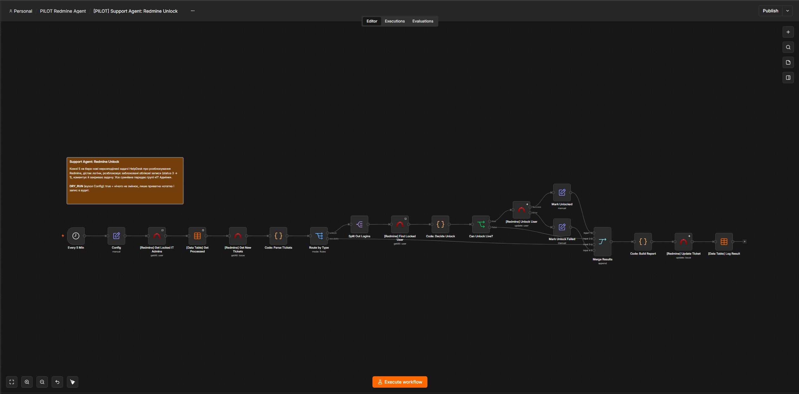

**Флоу 2. AD Account & Personal Mail**
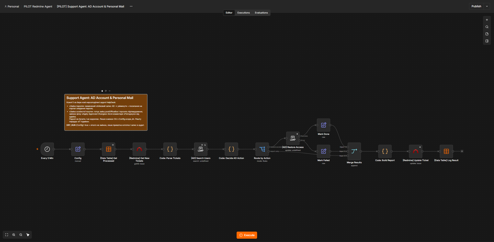

**Флоу 3. Apply Approved Changes**
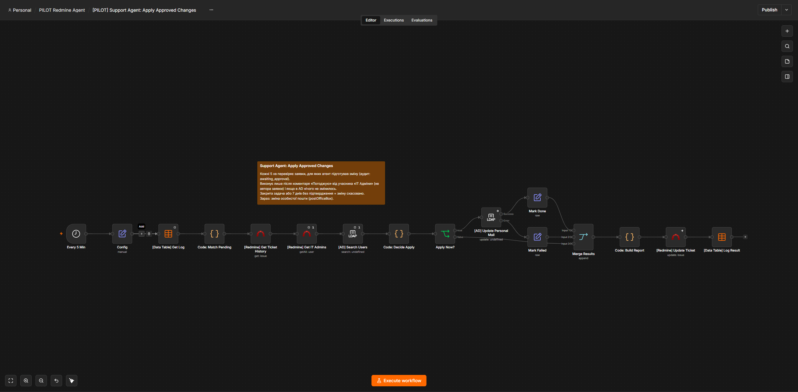

**Флоу 4. Google Guest Access**
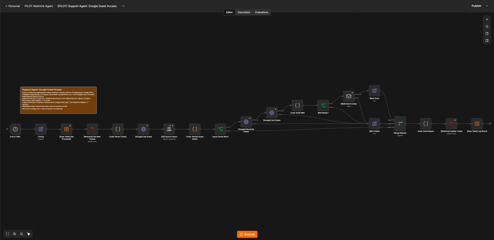

**Флоу 5. Google Guest Apply**
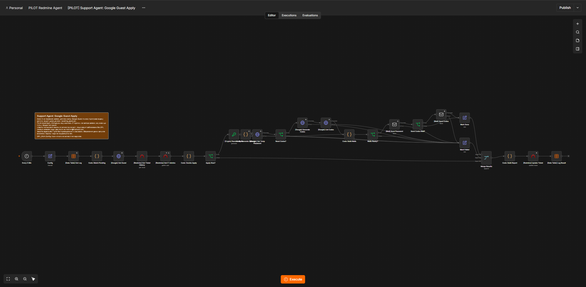

**Диспетчер**
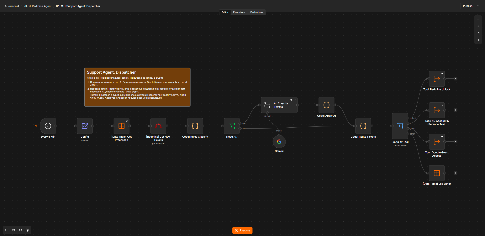

**Offboarding Now**
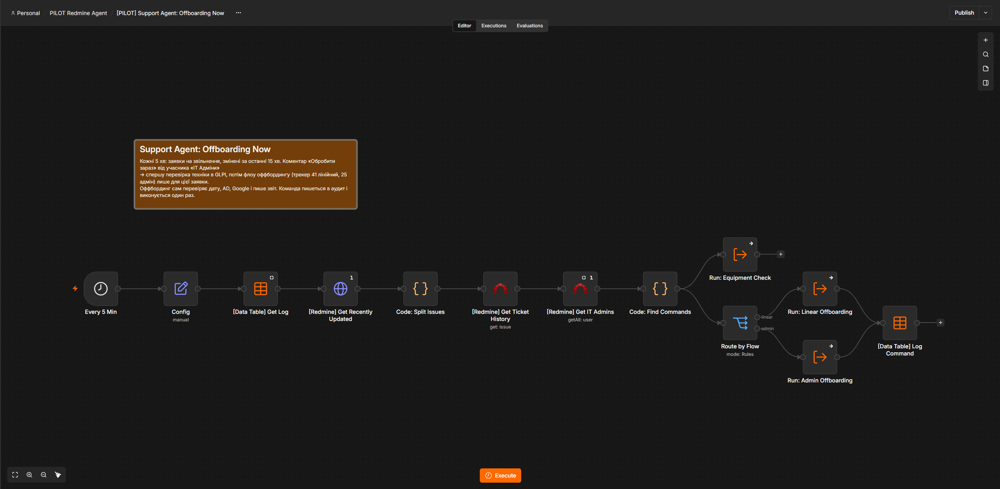

## Схема

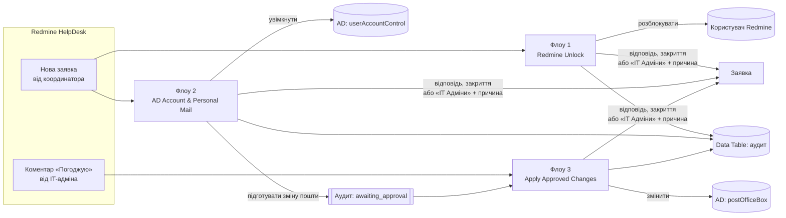

### Флоу 1. Support Agent: Redmine Unlock (19 вузлів)

```mermaid
flowchart LR
    S[Every 5 Min] --> C[Config] --> GA["[Redmine] Get Locked IT Admins"] --> GP["[Data Table] Get Processed"] --> GT["[Redmine] Get New Tickets"] --> PT["Code: Parse Tickets"] --> RT{Route by Type}
    RT -->|unlock| SO[Split Out Logins] --> FL["[Redmine] Find Locked User"] --> DU["Code: Decide Unlock"] --> CU{Can Unlock Live?}
    CU -->|так| UU["[Redmine] Unlock User"] --> MU[Mark Unlocked / Failed] --> M[Merge Results]
    CU -->|ні або DRY RUN| M
    RT -->|escalate| M
    M --> BR["Code: Build Report"] --> UT["[Redmine] Update Ticket"] --> LR["[Data Table] Log Result"]
```

### Флоу 2. Support Agent: AD Account & Personal Mail (16 вузлів)

```mermaid
flowchart LR
    S[Every 5 Min] --> C[Config] --> GP["[Data Table] Get Processed"] --> GT["[Redmine] Get New Tickets"] --> PT["Code: Parse Tickets"] --> SU["[AD] Search Users"] --> DA["Code: Decide AD Action"] --> RA{Route by Action}
    RA -->|enable| EA["[AD] Enable Account"] --> MD[Mark Done / Failed] --> M[Merge Results]
    RA -->|решта: зміна пошти на підтвердження, ескалація, DRY RUN| M
    M --> BR["Code: Build Report"] --> UT["[Redmine] Update Ticket"] --> LR["[Data Table] Log Result"]
```

### Флоу 3. Support Agent: Apply Approved Changes (17 вузлів)

```mermaid
flowchart LR
    S[Every 5 Min] --> C[Config] --> GL["[Data Table] Get Log"] --> MP["Code: Match Pending"] --> TH["[Redmine] Get Ticket History"] --> IA["[Redmine] Get IT Admins"] --> SU["[AD] Search Users"] --> DA["Code: Decide Apply"] --> AN{Apply Now?}
    AN -->|так| UM["[AD] Update Personal Mail"] --> MD[Mark Done / Failed] --> M[Merge Results]
    AN -->|ні| M
    M --> BR["Code: Build Report"] --> UT["[Redmine] Update Ticket"] --> LR["[Data Table] Log Result"]
```

### Диспетчер і ІІ (Support Agent: Dispatcher, 16 вузлів)

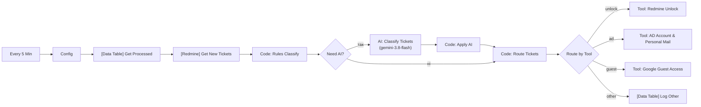

- Один вхід для всіх нових заявок. Спершу правила; де вони мовчать, ІІ (Gemini 3.8 Flash) повертає строгим JSON тип, логіни й адреси.
- ІІ лише класифікує. Дію виконує інструмент (флоу 1, 2, 4 у режимі під-воркфлоу, `tools/subflow.py`) з усіма своїми перевірками; підказка ІІ (`ai`) використовується, лише коли правила самого інструмента заявку не впізнали. Помилка ІІ = зайва ескалація людям, а не неправильна дія.
- Заявки «other» пишуться в аудит, тож ІІ не класифікує їх удруге; їх беруть люди.
- Перевірка на історії (993 заявки): ІІ правильно визначає тему ≈90% (ручна вибірка), знаходить ≈10% заявок понад правила; Gemini 3.8 Flash точніша за 2.5 Flash і не гірша за 3.1 Pro (`docs/analysis.md`).
- Інструменти-під-воркфлоу в n8n мають бути активними (інакше їх не можна викликати); вони спрацьовують лише від виклику диспетчера.

## Як приймаються рішення

**Загальне для всіх флоу**
- Беруться лише нові нерозподілені заявки (статус New, без виконавця) у проєкті HelpDesk, трекер «Звернення користувачів».
- Автор заявки має бути в списку координаторів (`allowed_author_ids` у вузлі Config). Диспетчер відсіює заявки інших авторів на самому початку: вони не потрапляють ні в інструменти, ні в ІІ, їхній текст нікуди не надсилається.
- Логіни шукаються в темі й описі (формати `ms.x.y`, `mdy_x`, `x.surname`, локальна частина корпоративної пошти). Кожен логін перевіряється точним збігом у Redmine або AD; «схожі» не підходять.
- Оброблені заявки записуються в аудит, тож повторний прогін нічого не дублює. У режимі DRY RUN агент лише пише приватну нотатку «зробив би так»; у бойовому режимі заявки, яких торкався тільки DRY RUN, обробляються заново.
- Ескалація = виконавець «IT Адміни» + приватна нотатка з причиною. Задачу з виконавцем агент більше не бере.

**Розблокування Redmine**
- Розблоковує лише користувачів у статусі «заблокований» з точним збігом логіна; не чіпає адміністраторів Redmine і учасників «IT Адміни».
- Якщо частину логінів розблоковано, а частину ні (не знайдено, уже активний), заявку не закриває, а передає людям з переліком.

**Пароль (увімкнення облікового запису AD)**
- Лише якщо обліковий запис вимкнений, лежить у дозволеному OU (`scope_dn`), не в привілейованих групах і в AD є особиста пошта (туди прийде посилання з порталу).
- Якщо в заявці вказано особисту пошту і вона не збігається з AD, агент не діє.
- Обліковий запис уже активний = потрібні нові дані для входу, це робить людина.

**Зміна особистої пошти (через підтвердження)**
1. Флоу 2 перевіряє логін, OU, групи, що обліковий запис увімкнений, і пише приватну нотатку «було → стане, щоб виконати, напишіть «Погоджую»». Стара адреса в заявці не обов'язкова; якщо вона є і не збігається з AD, у нотатці буде попередження.
2. Флоу 3 виконує зміну, лише якщо після підготовки з'явився коментар «Погоджую» або «Підтверджую» від учасника «IT Адміни», який не є автором заявки, і в AD нічого не змінилось (той самий DN, OU, пошта). Інші слова («ок») ігнорує. Підтвердження від інших людей = відмова. Задачу закрито або 7 днів без підтвердження = зміну скасовано.

### Флоу 4. Support Agent: Google Guest Access (21 вузол)

```mermaid
flowchart LR
    S[Every 5 Min] --> C[Config] --> GP["[Data Table] Get Processed"] --> GT["[Redmine] Get New Tickets"] --> PT["Code: Parse Tickets"] --> GG["[Google] Get Guest"] --> SU["[AD] Search Users"] --> DG["Code: Decide Guest Action"] --> IC{Issue Codes Now?}
    IC -->|так| GC["[Google] Generate Codes"] --> LC["[Google] List Codes"] --> BM["Code: Build Mail"] --> MR{Mail Ready?} --> SM["[Mail] Send Codes"] --> MD[Mark Done / Failed] --> M[Merge Results]
    IC -->|ні або DRY RUN| M
    M --> BR["Code: Build Report"] --> UT["[Redmine] Update Ticket"] --> LR["[Data Table] Log Result"]
```

**Гостьові акаунти Google (флоу 4)**
- Гостьовий акаунт виникає, коли робочу пошту SOGo запрошують у Google Chat; адреса гостя `<логін>_example.com@guests.example.com.guest.google`, увійти можна лише під цією повною адресою.
- Агент лише видає резервні коди (Directory API `verificationCodes`): людина входить своїм паролем, вводить код замість другого кроку й одразу налаштовує 2FA. Новий пароль агент не ставить, двоетапну перевірку не вимикає: такі заявки йдуть людям.
- Перевірки: координатор; рівно один логін AD; обліковий запис AD увімкнений і в робочому OU; гість існує, гостьовий, не адміністратор, не призупинений і прив'язаний саме до `<логін>@example.com` (`guestAccountInfo.primaryGuestEmail`).
- Що видавати, вирішує стан гостя в Google, а не лише слова в заявці: лише код (пароль людина пам'ятає) іде без підтвердження; пароль (або «заблоковано без 2FA», тоді й коди) іде через «Погоджую» від IT-адміна. Пароль і код надсилаються двома окремими листами лише на робочу пошту. Пароль генерується флоу 5 у момент виконання (випадковість вузла Crypto) і не зберігається ні в аудиті, ні в Redmine; збереження даних запусків вимкнено, щоб секрети не лишались в історії n8n.
- Перевірено на живому тестовому гості: код дає вхід у заблокований акаунт (екран «потрібно ввімкнути 2-Step Verification» → «Try another way» → резервний код); пароль, змінений адміністратором, відлік 7 днів не обнуляє. Льготний період Google = 7 днів від першого входу гостя.
- Сервісному акаунту Google потрібні області `admin.directory.user` і `admin.directory.user.security` (делегування на рівні домену).

### Флоу 5. Support Agent: Google Guest Apply (27 вузлів)

```mermaid
flowchart LR
    S[Every 5 Min] --> C[Config] --> GL["[Data Table] Get Log"] --> MP["Code: Match Pending"] --> GG["[Google] Get Guest"] --> TH["[Redmine] Get Ticket History"] --> IA["[Redmine] Get IT Admins"] --> DA["Code: Decide Apply"] --> AN{Apply Now?}
    AN -->|так| RB["[Crypto] Random Bytes"] --> GS["Code: Generate Secrets"] --> SP["[Google] Set Temp Password"] --> NC{Need Codes?}
    NC -->|так| GC["[Google] Generate / List Codes"] --> BM["Code: Build Mails"]
    NC -->|ні| BM
    BM --> MR{Mails Ready?} --> M1["[Mail] Send Password"] --> M2["[Mail] Send Codes"] --> MD[Mark Done / Failed]
    AN -->|ні, DRY RUN, відмова, скасування| M[Merge Results]
    MD --> M --> BR["Code: Build Report"] --> UT["[Redmine] Update Ticket"] --> LR["[Data Table] Log Result"]
```

- Бере заявки, для яких флоу 4 написав в аудит `guest_access / awaiting_approval`, і перевіряє коментарі: потрібне «Погоджую» або «Підтверджую» від учасника «IT Адміни», який не є автором заявки; інша людина або автор = відмова з поясненням.
- Перед виконанням повторно перевіряє гостя в Google і власника (пошта гостя прив'язана до `<логін>@example.com`). Заявку закрито або 7 днів без підтвердження = скасування.
- Пароль генерує вузол Crypto у момент дії, ставить його з обов'язковою зміною при вході; за потреби додає резервні коди. Пароль і коди йдуть двома окремими листами лише на робочу пошту; ніде не зберігаються, збереження даних запусків вимкнено.

### Offboarding Now (14 вузлів)

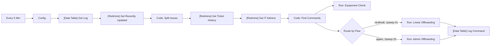

- Шукає в заявках на звільнення, змінених за останні 15 хвилин, коментар «Обробити зараз» від учасника «IT Адміни». Спершу запускає перевірку техніки в GLPI, потім флоу оффбордингу (лінійний або адмін) лише для цієї заявки. Команда пишеться в аудит і виконується один раз.
- Самі флоу оффбордингу й перевірки техніки живуть в окремому проєкті ([staff-offboarding](https://github.com/IlyaRumasov/staff-offboarding-automation)), працюють щодня о 18:00 (перевірка техніки щогодини) і не залежать від агента. Агент лише додає команду «обробити зараз». Перемикача DRY RUN у цього флоу немає, тому в тіні його не вмикають.

## Тіньовий режим (DRY RUN на бойовому Redmine)

У тіні працюють диспетчер, три інструменти, `Apply Approved Changes` і `Google Guest Apply`, усе з `dry_run = true`; `Offboarding Now` і «одиночні» версії флоу 1, 2, 4 вимкнені (дублювали б диспетчера).

- Агент читає заявки координаторів, класифікує, перевіряє дані в AD, Google, Redmine й пише в таблицю аудиту рядок із позначкою `dry_run`. У заявці лишається лише приватна нотатка «DRY RUN: що зробив би»; закриття, призначення, зміни в AD і Google, листи вимкнені.
- Шлях із підтвердженням теж перевіряється: підготовка пишеться в аудит як `awaiting_approval` з позначкою `dry_run`, а в сухому режимі флоу 3 і 5 дивляться на найновіший запис (і сухий теж), перевіряють «Погоджую» і пишуть нотатку «виконав би» або причину відмови. Для цього інженери в тіні пишуть приватний коментар «Погоджую» у заявках про зміну пошти й пароль гостя, а дію роблять вручну.
- Критерій переходу в бойовий режим: збіг із рішеннями інженерів не менше 98% на 30+ заявках без жодного небезпечного рішення. Перед вимкненням `dry_run` рядки сухого прогону видаляють з таблиці аудиту, інакше диспетчер пропустить заявки, яких торкалась тінь.

## Безпека
- Паролі: для облікових записів AD агент їх не генерує, не бачить і не надсилає. Для гостьових акаунтів Google (флоу 5) тимчасовий пароль генерується в момент дії після «Погоджую», ставиться зі зміною при вході, не зберігається ні в аудиті, ні в історії n8n, ні в заявці й надсилається окремим листом лише на `<логін>@example.com`.
- Сервісний обліковий запис AD потребує прав лише на три атрибути (`userAccountControl`, `postOfficeBox`, `lockoutTime`) у робочих OU. Для тестового OU права видано окремо.
- Секрети, id кредів і таблиць, адреси не в репозиторії: скрипти читають `tools/local_settings.json` (шаблон `tools/local_settings.example.json`), список координаторів у `tools/coordinators.txt`. Обидва файли в `.gitignore`. У JSON флоу замість кредів стоять заглушки (`<REDMINE_CRED>`, `<LDAP_CRED>`, `<AUDIT_TABLE>`, `<COORDINATOR_IDS>`).
- У тестових даних лише вигадані облікові записи (`test.unlock.NN`, `test.guest.NN`) і адреси `@example.com`.

## Тестування

Усі експерименти виконувались лише на тестовому Redmine, у тестовому OU AD і на тестових гостьових акаунтах Google. Тестові скрипти й фікстури лишаються в приватному репозиторії; тут їх немає, бо вони прив'язані до внутрішніх систем. Скрипти створюють тимчасову копію флоу в n8n (тригер замінено вебхуком), запускають її й видаляють.

Перевірені сценарії (усі пройдено):
- розблокування: один логін, кілька логінів, логін великими літерами з поштою в дужках, уже активний, неіснуючий, без логіна, учасник IT, змішана заявка;
- пароль: стандартна форма, вільний текст, уже активний, пошта в заявці не збігається з AD, обліковий запис в «Уволенные»;
- зміна пошти: лише нова адреса, стара не збігається, обліковий запис вимкнений, підтвердження від IT-адміна, від автора, від не-IT, «ок» замість «Погоджую»;
- DRY RUN нічого не змінює, повторний прогін нічого не дублює;
- помилки систем: Redmine не розблокував, AD не увімкнув і не змінив пошту, Google не видав кодів: заявка не закривається, іде «IT Адміни» з текстом помилки;
- диспетчер: заявки з вільним текстом розпізнано ІІ й виконано відповідними інструментами; сторонні заявки лишилися людям; другий прогін нічого не повторює і не кличе ІІ; заявки авторів поза списком координаторів не чіпаються й не йдуть в ІІ;
- гостьовий Google: форма «резервні коди», гостя немає, «забув пароль», обліковий запис поза робочим OU; вхід у заблокований гостьовий акаунт за резервним кодом перевірено на живому тестовому гості;
- шлях із підтвердженням у тіні: «Погоджую» від IT-адміна дає «виконав би», від автора заявки відмову з причиною.

## Як відновити
1. Імпортувати JSON з `workflows/` у n8n (підфлоу-інструменти диспетчера створюються з тих самих збірок через `tools/deploy.py`).
2. Створити Data Table аудиту з колонками `ticket_id` (number), `kind`, `logins`, `outcome`, `dry_run` (boolean), `details`, `at`, `payload` і вказати її у вузлах `[Data Table] ...`.
3. Призначити креди: Redmine (обліковий запис бота з правами адміністратора Redmine, потрібні для розблокування) і LDAP (права на `userAccountControl`, `postOfficeBox` у робочих OU).
4. У вузлі Config кожного флоу заповнити `project_id`, `tracker_id`, `allowed_author_ids`, перевірити `scope_dn`, `admins_group_id`, `resolved_status_id`.
5. Залишити `dry_run = true`, увімкнути флоу і кілька тижнів порівнювати нотатки агента з тим, що роблять люди. Лише потім `dry_run = false`.

Для збирання з коду: `python tools/build_unlock.py`, `build_ad.py`, `build_apply.py` (заглушки), `tools/deploy.py` (вимкнені флоу з бойовими налаштуваннями з `local_settings.json`).

## Структура репозиторію
```
workflows/   флоу n8n (JSON із заглушками): інструменти, диспетчер, Apply, Offboarding Now
tools/       збирання флоу з Python, деплой в n8n
docs/        аналіз заявок і рішення
```

## Обмеження
- Це не повноцінний агент, а диспетчер із підказкою ІІ: модель лише класифікує, шлях виконання фіксований. Заявки типу «інше» (приблизно кожна шоста-четверта) йдуть людям. Наступний етап: LLM з інструментами лише для читання й приватними нотатками для таких заявок.
- Реальний запис у Google, надсилання листів і зміни в AD у бойовому режимі перевірено на тестових обліковках; на бойових даних тінь це не перевіряє (лише читання й рішення).
- Сервісні облікові записи (бот Redmine з правами адміністратора, службовий запис AD) мають ширші права, ніж потрібно; обмеження за OU та виключення адміністраторів реалізовано в логіці флоу. Звуження прав заплановано окремим кроком.
- `Offboarding Now` не має перемикача DRY RUN і вмикається останнім.
