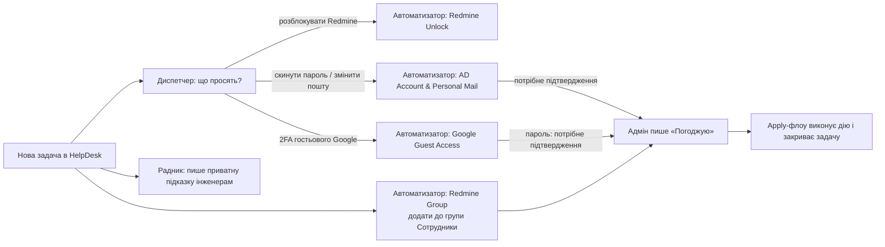

# Як усе влаштовано: простими словами

Це пояснення для тих, хто бачить систему вперше. Технічні подробності (вузли, регулярні вирази, схеми) лежать у `README.md` і в самих флоу.

## Що це

Перша лінія підтримки для Redmine HelpDesk. Хтось створює задачу («розблокуйте Redmine», «додайте до проєкту», «не можу увійти в Google»), а система:

1. сама розпізнає, про що просять;
2. або виконує типове прохання, або пише інженерам підказку, що робити;
3. усе, що змінює щось важливе, робить лише після того, як адмін напише в задачі коментар **«Погоджую»**.

Усе працює в n8n, у папці **Support Agent**.

## Дві ролі: радник і автоматизатор

Це головне, що треба розрізняти. Назва кожного флоу починається зі слова-ролі, і те саме написано в теґах.

| Роль | Теґ | Що робить | Чи змінює щось |
|---|---|---|---|
| **Радник** (ІІ-агент) | `agent-радник` | Читає нову задачу, шукає схожі старі задачі й затверджені інструкції, перевіряє факти (стан облікового запису, історію), пише **приватну нотатку** інженерам з готовою порадою | Ні, лише читає й радить |
| **Автоматизатор** | `agent-автоматизатор` | Виконує типове прохання за чіткими правилами (розблокувати, скинути, додати в групу) і відповідає в задачі | Так, але небезпечне лише після «Погоджую» |
| **Сервіс** | `сервіс` | Допоміжне: оновлює базу знань, збирає оцінки порад, приймає події з Redmine | Лише своє службове |
| **Інструмент** | `інструмент` | Не запускається сам: його викликає інший флоу (радник чи диспетчер) | Залежить від флоу |

Простіше: **радник думає й пише, автоматизатор робить**.

## Що відбувається з однією задачею

1. **Радник** і **Диспетчер** бачать нову нерозподілену задачу приблизно за 2 хвилини.
2. Радник додає приватну нотатку з пропозицією (її бачать лише інженери). Якщо підходить затверджена інструкція («плейбук»), він посилається на неї.
3. Диспетчер вирішує, чи це типове прохання. Якщо так, викликає потрібний флоу-інструмент. Якщо ні, нічого не робить, задачу бере людина.
4. Безпечні дії (розблокувати акаунт, видати резервні коди) автоматизатор виконує сам і відповідає авторові. Людина зазвичай нічого не робить.
5. Небезпечні дії (пароль, зміна пошти, додавання до групи) автоматизатор лише **готує** і пише в задачі, що саме збирається зробити. Адмін із групи «IT Адміни» (не автор задачі) пише **«Погоджую»**. Тоді другий флоу («Apply») за 5 хвилин виконує дію, перевіряє результат і закриває задачу.
6. Усе сумнівне (не знайшов людину, адмінський акаунт, забагато адрес) автоматизатор передає групі «IT Адміни» з поясненням причини.

## Що є в папці n8n

### Радник (`agent-радник`)
- **Радник: Агент**: сам ІІ-агент, пише підказку в задачу.
- **Радник (інструмент): …** (6 штук): його «руки», лише читання: історія задачі, схожі задачі й інструкції, політики, стан облікового запису в AD, стан гостя в Google, перевірка техніки в GLPI.

### Автоматизатор (`agent-автоматизатор`)
| Флоу | Що робить | Підтвердження |
|---|---|---|
| **Диспетчер** | Розпізнає тип задачі й викликає потрібний інструмент | не потрібне |
| **Redmine Unlock (інструмент)** | Розблокує обліковий запис у Redmine | не потрібне |
| **AD Account & Personal Mail (інструмент)** | Скидання пароля AD, зміна особистої пошти | потрібне «Погоджую» для пошти |
| **Google Guest Access (інструмент)** | Резервні коди 2FA для гостьового Google | коди без підтвердження, пароль через «Погоджую» |
| **Apply Approved Changes** | Виконує підтверджені зміни (пошта AD) | так |
| **Google Guest Apply** | Видає тимчасовий пароль гостя після «Погоджую» | так |
| **Redmine Group** | Знаходить людину в Redmine і готує додавання до групи «Сотрудники» (проєкти за замовчуванням) | запит |
| **Redmine Group Apply** | Після «Погоджую» додає до групи, перевіряє, відповідає, закриває | так |
| **Equipment Check (GLPI) (інструмент)** | Для заявок на звільнення (проєкт starter-leaver, трекери «Admin \| Leaver» і «GA \| Leaver») перевіряє в GLPI, чи числиться за людиною техніка, і пише результат коментарем у заявку; цей коментар читають флоу оффбордингу. Щогодини о :30, а також за командою з номером заявки (її викликає «Offboarding Now», згодом вебхук) | не потрібне (лише читає GLPI, пише коментар) |

Вимкнені флоу лежать у підпапці **Дублі (вимкнені)** і мають теґ `agent-вимкнено-дублі` (Redmine Unlock, AD Account & Personal Mail, Google Guest Access без «(інструмент)») це старі окремі копії. Їх не вмикати: у роботі їхні «(інструмент)»-версії. **Offboarding Now** теж вимкнений, його вмикають лише свідомо.

### Сервіс (`сервіс`)
- **KB Weekly Refresh**: щопонеділка о 08:00 додає в базу знань нові закриті задачі (обезличені).
- **Advisor Feedback**: щодня о 08:00 збирає оцінки порад радника.
- **Redmine Webhook Receiver**: приймає події з Redmine (чекає, поки адміністратор поставить плагін).

## Режими: бойовий чи «сухий прогін»

У кожному флоу-автоматизаторі є вузол **Config** з перемикачем `dry_run`:

- `true`: **сухий прогін**. Нічого не змінює, лише пише приватну нотатку «DRY RUN: зробив би …» і рядок у журнал.
- `false`: **бойовий режим**.

Зараз усі активні флоу працюють у бойовому режимі (Redmine Group і Redmine Group Apply переведено в бій 6.11; будь-яка зміна групи все одно потребує «Погоджую»).

## Безпека в трьох реченнях

1. Небезпечне виконується лише після «Погоджую» від адміна з групи «IT Адміни», який не є автором задачі.
2. Секрети (паролі, коди, ключі) не потрапляють у Redmine, журнал і репозиторій; для флоу з паролями вимкнено збереження історії запусків.
3. Перевіряється кожна дія: стан людини до, результат після; при будь-якому сумніві задача йде людині.

## Де дивитися, коли щось не так

- **Журнал дій**: таблиця `support_agent_audit` у n8n (Data tables). Кожен рядок: задача, тип, результат, чи був сухий прогін.
- **Приватні нотатки в задачі**: що саме агент зробив чи чому не став.
- **Executions** у n8n: запуски флоу (для флоу з паролями історії навмисно немає).
- **Помилки** автоматично створюють задачу через `[System] Global Error Handler`.

## Техніка в GLPI: один код, два місця

Пошук людини і її техніки в GLPI написаний один раз, у `staff-offboarding/src/glpi.js`. Сборка вставляє його у два флоу: **Equipment Check (GLPI)** (заявки на звільнення, пише коментар) і **Радник (інструмент): GLPI Equipment** (лише читає для підказки радника). Якщо GLPI змінить API, правимо один файл і перезбираємо обидва.

Equipment Check тепер у папці Support Agent і розглядається як інструмент агента. Коли адмін поставить плагін вебхуків, приймач подій зможе викликати його одразу при створенні заявки на звільнення, а щогодинний запуск лишиться як страховка: техніку можуть повернути, і коментар оновиться.

## Для розробника

Усі флоу збираються скриптами `tools/build_*.py`, розгортаються `tools/deploy*.py` (нові флоу створюються вимкненими, у режимі DRY RUN). Тести: `tools/test_*.py`, `tools/run_test_*.py` на тестовому Redmine. Деталі та мапа вузлів: `README.md`.
